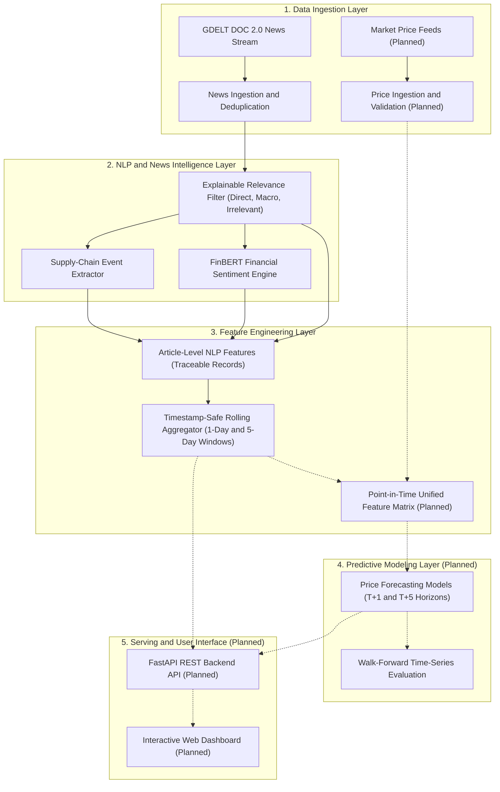
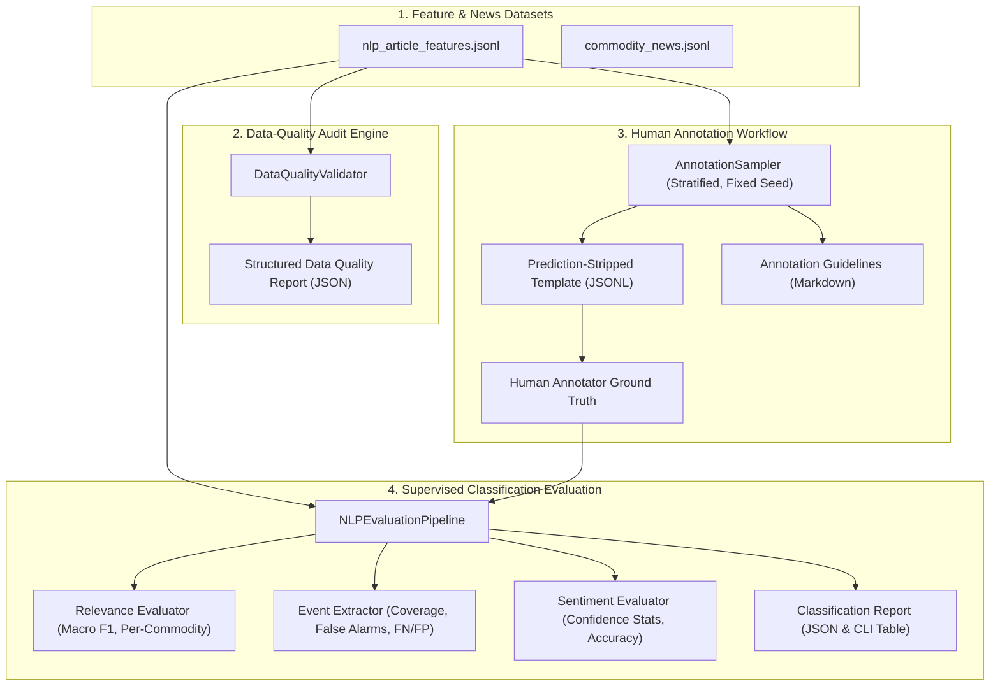

# AI-Powered Commodity Price Prediction and Supply-Chain Intelligence

An end-to-end artificial intelligence platform designed to forecast commodity price movements and analyze global supply-chain risks. The system synthesizes quantitative financial time-series data with unstructured global news intelligence—extracting domain-specific financial sentiment, supply-chain disruptions, and macroeconomic indicators with strict point-in-time temporal alignment.

---

## Table of Contents
1. [Project Overview](#1-project-overview)
2. [Problem Statement & Motivation](#2-problem-statement--motivation)
3. [Project Objectives](#3-project-objectives)
4. [Target Commodities](#4-target-commodities)
5. [Intended Prediction Horizons](#5-intended-prediction-horizons)
6. [Data Sources & Information Strategy](#6-data-sources--information-strategy)
7. [System Architecture & Planned Data Flow](#7-system-architecture--planned-data-flow)
8. [Team Roles & Responsibilities](#8-team-roles--responsibilities)
9. [Current Implementation Status](#9-current-implementation-status)
10. [Technology Stack](#10-technology-stack)
11. [Setup & Installation](#11-setup--installation)
12. [Usage Instructions](#12-usage-instructions)
13. [Testing & Quality Assurance](#13-testing--quality-assurance)
14. [NLP & News Intelligence Module Reference](#14-nlp--news-intelligence-module-reference)
15. [Limitations & Future Work](#15-limitations--future-work)
16. [Repository Workflow & Collaboration](#16-repository-workflow--collaboration)

---

## 1. Project Overview

Commodity markets are the foundation of the global industrial economy. Raw materials such as crude oil, copper, and gold dictate operating costs across manufacturing, transportation, electronics, and construction. Unlike traditional financial assets whose valuations largely reflect corporate earnings reports, commodity prices are acutely sensitive to real-world physical and geopolitical shocks—mine strikes, pipeline sabotage, shipping lane blockades, export tariffs, and unexpected inventory draws.

This project delivers an integrated machine learning and natural language processing (NLP) framework that continuously monitors global news streams, filters signal from noise, classifies supply-chain events, evaluates domain sentiment using FinBERT, and generates point-in-time feature vectors to forecast commodity price dynamics.

---

## 2. Problem Statement & Motivation

### The Challenge
1. **Extreme Volatility & Physical Sensitivity**: Commodity markets experience rapid price regime shifts driven by real-world physical disruptions and macroeconomic events that occur outside organized financial exchanges.
2. **Lag in Purely Quantitative Models**: Traditional econometric models (e.g., ARIMA, GARCH) and technical momentum indicators (e.g., RSI, MACD) extrapolate strictly from past price series. They have no visibility into breaking real-world disruptions until those shocks have already impacted market prices.
3. **Unstructured News Deluge & Noise**: Global news aggregators produce tens of thousands of articles daily. A vast majority of mentions are uninformative, boilerplate, figurative ("Olympic gold medal", "crude joke"), or tangential. Manual analysis cannot scale to capture these nuances in real time.
4. **Lookahead Data Leakage in Backtesting**: Incorporating news data into quantitative trading models frequently suffers from lookahead bias—evaluating news published *after* a trading cutoff as if it were known *prior* to that cutoff.

### Project Motivation
By pairing rigorous time-series econometric principles with automated, explainable NLP intelligence, this platform transforms unstructured global news into structured, timestamp-anchored features. This enables downstream machine learning models to capture early warning indicators of supply bottlenecks, demand shifts, and policy interventions with zero lookahead leakage.

---

## 3. Project Objectives

- **Automated Global News Ingestion**: Continuously discover and ingest commodity-focused news articles from the global GDELT DOC 2.0 API with robust rate-limiting and deduplication.
- **Explainable Relevance Classification**: Implement a rule-based, transparent relevance filter that separates direct operational commodity developments and macroeconomic drivers from sports, slang, and generic noise.
- **Financial Domain Sentiment Analysis**: Quantify article sentiment using a pretrained financial model (`ProsusAI/finbert`), distinguishing model confidence from directional sentiment polarity.
- **Supply-Chain Event Extraction**: Automatically extract operational disruptions, inventory changes, geopolitical conflicts, policy actions, and production shifts, mapping each event to an economically grounded impact hypothesis.
- **Timestamp-Safe Feature Engineering**: Construct standardized article-level datasets and backward-looking rolling window feature matrices ($T-1\text{d}$, $T-5\text{d}$) anchored strictly to point-in-time prediction cutoffs.
- **Multi-Horizon Price Forecasting**: Train and evaluate predictive machine learning models to forecast price return and directional movement across next-day and weekly horizons.
- **Interactive Decision Dashboard**: Serve predictions, risk alerts, sentiment timelines, and event feeds through a high-performance REST API and web user interface.

---

## 4. Target Commodities

The platform focuses on three benchmark commodities representing distinct industrial and economic segments:

| Commodity | Sector & Role | Key Supply-Chain & Price Drivers |
| :--- | :--- | :--- |
| **Copper (`copper`)** | **Industrial Metal ("Dr. Copper")**<br/>Primary barometer of global industrial and economic health. Vital for power grids, electric vehicles, electronics, and construction. | • Mining production disruptions & labor strikes (Chile, Peru, Indonesia)<br/>• Smelter operational bottlenecks and treatment charges<br/>• China manufacturing PMI and infrastructure stimulus<br/>• Warehouse inventory levels on LME, SHFE, and COMEX |
| **Gold (`gold`)** | **Precious Metal & Monetary Asset**<br/>Global safe-haven asset, store of value, and hedge against inflation and systemic risk. | • Central bank reserve accumulation policies<br/>• US Federal Reserve interest rate policy and real Treasury yields<br/>• US Dollar Index (DXY) currency fluctuations<br/>• Escalating geopolitical conflict and sovereign debt risk |
| **Crude Oil (`crude oil`)** | **Energy Benchmark (Brent / WTI)**<br/>Fundamental input for global transportation, thermal energy, petrochemicals, and macro inflation. | • OPEC+ production quotas and compliance adherence<br/>• Geopolitical tensions near transit choke-points (Strait of Hormuz, Red Sea)<br/>• US commercial crude inventories (EIA weekly petroleum status)<br/>• Refinery outages, pipeline stoppages, and strategic reserve releases |

---

## 5. Intended Prediction Horizons

Predictive modeling is structured around two distinct operational time horizons:

1. **Next Trading Day ($T+1$)**:
   - **Target**: Next business day price return ($\ln(P_{t+1}/P_t)$) and directional movement ($\text{sign}(\Delta P)$).
   - **Operational Objective**: Short-term tactical risk positioning. Captures immediate market absorption of breaking overnight news, unscheduled mine shut-ins, or sudden geopolitical escalations.
2. **Next Five Trading Days ($T+5$, One Trading Week)**:
   - **Target**: 5-day cumulative price return ($\ln(P_{t+5}/P_t)$) and weekly trend regime.
   - **Operational Objective**: Weekly strategic inventory planning and hedging. Captures persistent operational bottlenecks, cumulative inventory draws/builds, and the phased implementation of monetary and trade policy.

---

## 6. Data Sources & Information Strategy

The project integrates four primary streams of market information:

1. **Historical Market Prices (Planned)**: Daily OHLCV price series, log returns, realized volatility, and technical indicators (e.g., Simple/Exponential Moving Averages, RSI, MACD).
2. **Macroeconomic Indicators (Planned)**: Global manufacturing PMIs, US CPI/PPI inflation releases, central bank interest rate decisions, and weekly EIA/API petroleum status reports.
3. **News Sentiment Intelligence (Implemented)**: Domain-specific sentiment probabilities from FinBERT (`ProsusAI/finbert`), measuring winning-class model confidence, windowed net polarity, and confidence-weighted sentiment balance.
4. **Supply-Chain Events (Implemented)**: Rule-based identification of operational events (`supply_disruption`, `demand_change`, `geopolitical_risk`, `inventory_change`, `policy_action`, `production_change`) with directional market impact hypotheses (`potentially_bullish`, `potentially_bearish`).
5. **Strict Point-in-Time Alignment**: All news and event signals are aggregated strictly over backward-looking windows $[T_{\text{cutoff}} - W, T_{\text{cutoff}}]$. Any article published after $T_{\text{cutoff}}$ is strictly excluded to eliminate lookahead leakage.

---

## 7. System Architecture & Planned Data Flow

The platform follows a decoupled, modular layered architecture:



### Data Flow Overview:
1. **Discovery & Collection**: GDELT DOC 2.0 is queried with targeted Boolean filters; financial market APIs supply historical price data.
2. **Filtering & Normalization**: Articles are normalized into UTC timestamps, stripped of query artifacts, and filtered into 4-way relevance classes.
3. **Intelligence Extraction**: Directly and potentially relevant headlines pass through the FinBERT sentiment model and the rule-based event taxonomy.
4. **Feature Assembly**: Article records are joined via canonical composite keys `(commodity, url)` and aggregated into backward-looking rolling windows.
5. **Model Ingestion & Forecasting**: Aligned feature matrices feed machine learning models under walk-forward cross-validation.
6. **Delivery**: The backend API serves predictions, risk alerts, and sentiment feeds to the frontend user dashboard.

---

## 8. Team Roles & Responsibilities

The project is structured across five specialized engineering roles:

| Role | Domain | Primary Responsibilities |
| :--- | :--- | :--- |
| **MLOps 1** | **Data Engineering & Price Ingestion** | • Ingestion pipelines for historical and daily commodity market prices (OHLCV).<br/>• Price data cleaning, gap handling, dividend/split adjustments, and timestamp normalization.<br/>• Data validation, schema enforcement, and feature store persistence. |
| **MLOps 2** | **Price Prediction & Model Evaluation** | • Baseline forecasting models (Random Walk, ARIMA, Linear Regressors).<br/>• Advanced machine learning models (LightGBM, XGBoost, LSTM/GRU, Temporal Fusion).<br/>• Walk-forward cross-validation, hyperparameter tuning, and metric evaluation (MAE, RMSE, Directional Accuracy). |
| **MLOps 3** | **NLP & News Intelligence** *(Current Feature Branch)* | • News ingestion from GDELT DOC 2.0 with rate-limiting and deduplication.<br/>• Explainable 4-way news relevance classification.<br/>• Financial sentiment inference via FinBERT (`ProsusAI/finbert`).<br/>• Supply-chain event extraction and economic impact classification.<br/>• Point-in-time, leakage-safe rolling window feature aggregation. |
| **Web 1** | **Frontend Application** | • Modern interactive web user interface (React/TypeScript or Streamlit).<br/>• Commodity price chart visualization with forecast overlays and uncertainty bands.<br/>• News sentiment timeline, event alert notifications, and risk heatmaps. |
| **Web 2** | **Backend REST API** | • High-performance REST API service (FastAPI).<br/>• Endpoints serving price predictions, news sentiment histories, and event logs.<br/>• Caching layer, model inference orchestration, and OpenAPI documentation. |

---

## 9. Current Implementation Status

This repository is under active development. The table below delineates completed and committed modules from in-progress and planned components:

| Component | Responsible Role | Status | Notes |
| :--- | :--- | :--- | :--- |
| **News Ingestion & Deduplication** | MLOps 3 | ✅ **Implemented & Committed** | Rate-limited client, exponential backoff, URL deduplication (`run_pipeline.py`). |
| **Explainable News Relevance Filter** | MLOps 3 | ✅ **Implemented & Committed** | 4-way taxonomy, indicator extraction, noise filtering (`src/news_intelligence/relevance.py`). |
| **FinBERT Sentiment Analysis** | MLOps 3 | ✅ **Implemented & Committed** | Hugging Face Transformers integration, batching, lazy loading (`src/sentiment/`). |
| **Supply-Chain Event Extraction** | MLOps 3 | ✅ **Implemented & Committed** | 7 event classes, negation detection, economic impact rules (`src/event_extraction/`). |
| **Standardized NLP Feature Engineering** | MLOps 3 | ✅ **Implemented & Committed** | Multi-source joining, point-in-time window aggregator, leakage filtering (`src/features/`, `run_features.py`). |
| **NLP Evaluation & Data-Quality Validation** | MLOps 3 | ✅ **Implemented (Local)** | Data-quality audits, bias-free annotation sampler, multi-class classification metrics (`src/evaluation/`, `run_evaluation.py`). |
| **Price Data Ingestion & Validation** | MLOps 1 | 📋 **Planned** | Historical OHLCV ingestion pipelines and schema validation. |
| **Predictive Price Models (T+1, T+5)** | MLOps 2 | 📋 **Planned** | Baseline models, feature importance, and machine learning forecasters. |
| **Frontend Web Dashboard** | Web 1 | 📋 **Planned** | Interactive charts, risk heatmaps, and sentiment feeds. |
| **Backend REST API** | Web 2 | 📋 **Planned** | FastAPI endpoints for prediction serving and data integration. |
| **End-to-End Orchestration & CI/CD** | All | 📋 **Planned** | Automated ingestion schedules, Docker Compose containerization. |

---

## 10. Technology Stack

The repository utilizes the following verified technologies and dependencies:

- **Programming Language**: Python 3.10+ (tested on Python 3.14).
- **Deep Learning & Natural Language Processing**:
  - `torch` (PyTorch) — Neural compute backend for model inference.
  - `transformers` (Hugging Face) — Model loading and inference pipeline for `ProsusAI/finbert`.
- **HTTP & Network Ingestion**:
  - `requests` — HTTP communication with the GDELT DOC 2.0 API, configured with custom headers, polite rate-limiting delays, and exponential backoff.
- **Testing & Quality Assurance**:
  - `pytest` — 100% offline unit and integration test suite with synthetic fixtures and zero external network calls.
- **Data Storage & Serialization**:
  - Standard Library `json` & `pathlib` — Append-only JSON Lines (`.jsonl`) datasets for lightweight, transparent, and inspectable intermediate stages.
- **Planned Stack Additions**:
  - `fastapi` & `uvicorn` (Backend REST API)
  - `scikit-learn` & `lightgbm` (Price forecasting models)
  - `react` / `typescript` / `tailwind` (Frontend user interface)
  - `docker` & `docker-compose` (Containerized deployment)

---

## 11. Setup & Installation

### Prerequisites
- Python 3.10 or higher.
- Git.

### Step 1: Clone the Repository
```bash
git clone https://github.com/Adhvaithmutyam/AI-powered-Commodity-Price-Prediction-and-Supply-Chain-Intelligence-.git
cd AI-powered-Commodity-Price-Prediction-and-Supply-Chain-Intelligence-
```

### Step 2: Checkout the Feature Branch
```bash
git checkout feature/news-intelligence
```

### Step 3: Create and Activate a Virtual Environment
- **On Windows (PowerShell)**:
  ```powershell
  python -m venv .venv
  .\.venv\Scripts\Activate.ps1
  ```
- **On Linux / macOS (Bash)**:
  ```bash
  python -m venv .venv
  source .venv/bin/activate
  ```

### Step 4: Install Dependencies
```bash
pip install -r requirements.txt
```

---

## 12. Usage Instructions

The implemented NLP intelligence modules can be executed independently or sequentially via their CLI runners:

### 1. Ingest Raw News Articles
Fetches the latest commodity news records from GDELT DOC 2.0 using targeted domain queries:
```bash
python run_pipeline.py
```
*Optional Flag:* `--assess-relevance` applies the explainable relevance classifier during ingestion.
*Default Output:* `data/raw/commodity_news.jsonl`

### 2. Evaluate News Relevance
Evaluates ingested records against operational and macroeconomic signal indicators:
```bash
python run_relevance_eval.py --input data/raw/commodity_news.jsonl
```

### 3. Run FinBERT Financial Sentiment Analysis
Processes ingested records through the pretrained `ProsusAI/finbert` model:
```bash
python run_sentiment.py
```
*Default Output:* `data/processed/commodity_news_sentiment.jsonl`

### 4. Run Supply-Chain Event Extraction
Extracts concrete supply-chain events and evaluates directional market impact:
```bash
python run_event_extraction.py
```
*Default Output:* `data/processed/commodity_events.jsonl`

### 5. Generate Standardized NLP Feature Datasets
Combines sentiment, relevance, and event data into standardized article-level features and computes timestamp-safe rolling window aggregations:
```bash
python run_features.py --cutoff 2026-10-20T12:00:00Z --windows 1,5
```
*Optional Flags:*
- `--cutoff <ISO_TIMESTAMP>`: Point-in-time prediction cutoff (defaults to latest article timestamp).
- `--windows 1,5`: Comma-separated list of backward-looking window horizons in days.
- `--commodities copper,gold,crude oil`: Target commodities to process.
- `--skip-aggregated`: Skips window aggregation and builds only article-level features.
*Outputs:*
- `data/processed/nlp_article_features.jsonl` (article-level features)
- `data/processed/nlp_aggregated_features.jsonl` (windowed rolling features)

### 6. Run NLP Evaluation & Data-Quality Validation
Executes data quality audits, generates unbiased human annotation sample templates, manages multi-annotator packages, audits inter-annotator agreement (Cohen's Kappa), adjudicates label conflicts, converts completed CSV annotations, and evaluates model predictions against human ground truth:
```bash
# A. Audit data quality of article-level features
python run_evaluation.py --mode validate

# B. Generate a reproducible, bias-free human annotation template (JSONL + CSV)
python run_evaluation.py --mode sample --sample-size 50 --seed 42

# C. Prepare multi-annotator packages (primary + 20% overlap secondary + manifest)
python run_evaluation.py --mode package --input data/evaluation/annotation_sample.jsonl --output-dir data/evaluation/

# D. Import and validate completed human annotations from Excel CSV to JSONL
python run_evaluation.py --mode import-csv --input data/evaluation/annotation_package_primary.csv --output data/evaluation/human_ground_truth_primary.jsonl --strict

# E. Inter-annotator agreement audit and Cohen's Kappa calculation
python run_evaluation.py --mode agreement --primary data/evaluation/human_ground_truth_primary.jsonl --secondary data/evaluation/human_ground_truth_secondary.jsonl --adjudication-template data/evaluation/adjudication_template.csv

# F. Merge consensus annotations and human-adjudicated resolutions into final ground truth
python run_evaluation.py --mode adjudicate --primary data/evaluation/human_ground_truth_primary.jsonl --secondary data/evaluation/human_ground_truth_secondary.jsonl --adjudicated data/evaluation/adjudication_template.csv --output data/evaluation/human_ground_truth.jsonl

# G. Evaluate pipeline predictions against human-labeled ground truth
python run_evaluation.py --mode evaluate --ground-truth data/evaluation/human_ground_truth.jsonl
```
*Optional Flags:*
- `--input <PATH>`: Custom input JSONL or CSV file path.
- `--output <PATH>`: Output report JSON, sample template, or converted ground-truth JSONL path.
- `--output-dir <DIR>`: Output directory for multi-annotator package generation (default: `data/evaluation`).
- `--primary <PATH>`: Primary annotation file path (CSV or JSONL).
- `--secondary <PATH>`: Secondary annotation file path (CSV or JSONL).
- `--adjudicated <PATH>`: Completed human adjudication spreadsheet path (CSV or JSONL).
- `--adjudication-template <PATH>`: Output path to generate an Excel-friendly adjudication spreadsheet.
- `--overlap-fraction <FLOAT>`: Fraction of articles for secondary annotator overlap (default: 0.20).
- `--ground-truth <PATH>`: Labeled ground-truth JSONL file path for `evaluate` mode.
- `--cutoff <ISO_TIMESTAMP>`: Evaluation cutoff timestamp to detect future-dated articles.
- `--sample-size <N>`: Number of records to extract for annotation (default: 50).
- `--seed <INT>`: Random seed for deterministic sampling (default: 42).
- `--overwrite`: Explicitly authorize overwriting existing output files.
- `--strict`: Strict validation mode rejecting CSV conversion on taxonomy violations or duplicate identities.

---

## 13. Testing & Quality Assurance

The test suite is engineered for **100% offline execution with zero network access and zero external model downloads**. All tests run against synthetic JSON fixtures and mocked API clients.

To execute the full test suite:
```bash
python -m pytest -v
```

### Test Suite Structure:
- **`tests/test_client.py` (10 tests)**: Verifies GDELT API rate-limiting delays, exponential backoff, HTTP 429/5xx status handling, and network timeouts.
- **`tests/test_normalizer.py` (10 tests)**: Validates UTC timestamp parsing, ISO conversion, URL extraction, and whitespace stripping.
- **`tests/test_storage.py` (5 tests)**: Confirms JSONL record persistence, append mechanics, and cross-batch `(commodity, url)` deduplication.
- **`tests/test_pipeline.py` (4 tests)**: Tests end-to-end news ingestion orchestration and graceful partial failure recovery.
- **`tests/test_relevance.py` (19 tests)**: Validates 4-way classification, direct operational mining/oil signals, macroeconomic drivers (Fed rate cuts, CPI, PMI), sports/slang noise filtering, and schema preservation.
- **`tests/test_sentiment.py` (10 tests)**: Tests FinBERT output mapping, batch inference, lazy model initialization, and malformed text fallback.
- **`tests/test_event_extraction.py` (22 tests)**: Validates event classification across all 7 taxonomy classes, negation detection (e.g., "strike averted"), commodity-specific geopolitical rules, and missing data handling.
- **`tests/test_features.py` (23 tests)**: Verifies multi-source record joining, partial sentiment merge preservation, sentiment-only/event-only coexistence, multi-commodity identity retention, null-safe matched indicators, URL canonicalization, UTC timestamp normalization, exact window boundary inclusion/exclusion, strict future leakage filtering, unanchored timestamp handling, confidence mean vs. polarity calculations, relevant-only sentiment isolation, cutoff auditing, and pipeline execution.
- **`tests/test_evaluation.py` (59 tests)**: Validates multi-class classification metrics (precision, recall, F1, accuracy, macro/weighted averages), confusion matrix generation, zero-denominator and zero-support resilience, missing/abstained prediction penalization, data-quality auditing (composite identity deduplication, URL syntax, missing/unparseable timestamps, future-date cutoff filtering, out-of-bounds confidence validation, rule non-match vs missing pipeline steps), deterministic stratified annotation sampling without model prediction leakage, dual JSONL and Excel-friendly CSV export with UTF-8 BOM, water-filling quota allocation for imbalanced commodity pools, domain evaluators (Relevance, Events, Sentiment), strict isolation against cross-article index fallback, duplicate ground-truth detection, conditional event-type accuracy, annotated CSV-to-JSONL conversion, Excel UTF-8 BOM ingestion, taxonomy compliance checks, missing/partial annotation detection, duplicate identity rejection, cross-commodity shared URL preservation, spreadsheet formula injection defense (OWASP DDE prevention), target file overwrite protection, multi-annotator package generation (primary + 20% stratified overlap secondary + manifest), exact mathematical Cohen's Kappa computation ($\kappa$) with degenerate zero-variance handling (indeterminate 0/0 protection), Landis & Koch agreement benchmarks, inter-annotator disagreement auditing, human adjudication template generation, strict prevention of silent primary label adoption on unresolved disputes, consensus ground-truth merging, formula desanitization, end-to-end multi-annotator workflow integration, and CLI command execution across all modes.

*Total: 103 committed tests on `feature/news-intelligence`, expanding to 162 tests with the Task 6 Phase 1, Phase 2A, and Phase 2B evaluation and quality control modules.*

---

## 14. NLP & News Intelligence Module Reference

### Project Directory Layout
```text
├── .gitignore                      # Excludes venv, datasets (.jsonl), model weights, caches
├── requirements.txt                # Production dependencies (torch, transformers, requests, pytest)
├── run_pipeline.py                 # News ingestion CLI runner
├── run_sentiment.py                # FinBERT sentiment CLI runner
├── run_event_extraction.py         # Supply-chain event extraction CLI runner
├── run_relevance_eval.py           # Relevance evaluation CLI runner
├── run_features.py                 # NLP feature engineering CLI runner
├── run_evaluation.py               # NLP evaluation & data-quality validation CLI runner
├── data/
│   ├── raw/                        # Ingested news records (git-ignored)
│   ├── processed/                  # Enriched sentiment, event, and feature datasets (git-ignored)
│   └── evaluation/                 # Generated annotation templates and evaluation reports (git-ignored)
├── src/
│   ├── news_intelligence/          # News ingestion, normalizer, and relevance module
│   ├── sentiment/                  # FinBERT financial sentiment inference module
│   ├── event_extraction/           # Rule-based supply-chain event extraction module
│   ├── features/                   # Standardized feature builder & timestamp aggregator module
│   └── evaluation/                 # Evaluation metrics, data quality validation, and annotation sampler
└── tests/                          # 100% offline unit and integration test suite
```

### Data Schemas

#### Article-Level NLP Feature Record (`nlp_article_features.jsonl`)
```json
{
  "commodity": "copper",
  "article_url": "https://reuters.com/copper-strike",
  "article_title": "Chilean copper mine strike halts operations",
  "article_publication_timestamp": "2026-10-20T10:00:00Z",
  "domain": "reuters.com",
  "language": "English",
  "source_country": "Chile",
  "fetch_timestamp": "2026-10-20T11:00:00Z",
  "provider": "gdelt",
  "relevance_class": "directly_relevant",
  "relevance_score": 0.88,
  "relevance_explanation": "Headline explicitly references target commodity and operational/market signals (mining_production, supply_disruption). Assessment based on headline analysis; full article text was not analyzed.",
  "matched_relevance_indicators": ["commodity_copper", "mining_production", "supply_disruption"],
  "sentiment_label": "negative",
  "sentiment_score": 0.9412,
  "sentiment_model": "ProsusAI/finbert",
  "sentiment_status": "success",
  "event_type": "supply_disruption",
  "event_impact_direction": "potentially_bullish",
  "event_confidence": 0.88,
  "extraction_status": "success",
  "evidence_fact": "mine strike halts operations",
  "implication_rationale": "Stoppage curtails refined copper supply.",
  "feature_status": "complete"
}
```

#### Windowed Aggregated Feature Record (`nlp_aggregated_features.jsonl`)
```json
{
  "commodity": "copper",
  "cutoff_timestamp": "2026-10-20T12:00:00Z",
  "cutoff_source": "explicit",
  "window_days": 1,
  "window_start_timestamp": "2026-10-19T12:00:00Z",
  "window_end_timestamp": "2026-10-20T12:00:00Z",
  "article_count": 3,
  "relevant_article_count": 2,
  "directly_relevant_count": 1,
  "potentially_relevant_count": 1,
  "irrelevant_count": 1,
  "uncertain_count": 0,
  "relevance_score_mean": 0.5667,
  "sentiment_positive_count": 1,
  "sentiment_negative_count": 1,
  "sentiment_neutral_count": 1,
  "sentiment_missing_count": 0,
  "sentiment_confidence_mean": 0.8000,
  "sentiment_score_mean": 0.8000,
  "net_sentiment_polarity": 0.0000,
  "confidence_weighted_sentiment_polarity": -0.0333,
  "relevant_sentiment_positive_count": 1,
  "relevant_sentiment_negative_count": 1,
  "relevant_sentiment_neutral_count": 0,
  "relevant_net_sentiment_polarity": 0.0000,
  "relevant_confidence_weighted_polarity": -0.0500,
  "event_type_counts": {
    "supply_disruption": 1,
    "demand_change": 1,
    "geopolitical_risk": 0,
    "inventory_change": 0,
    "policy_action": 0,
    "production_change": 0,
    "other": 1
  },
  "event_impact_counts": {
    "potentially_bullish": 1,
    "potentially_bearish": 1,
    "mixed": 0,
    "unknown": 1
  },
  "high_confidence_event_count": 2,
  "relevant_high_confidence_event_count": 2,
  "future_articles_filtered": 0,
  "unanchored_articles_excluded": 0
}
```

### Econometric Anti-Leakage & Polarity Protocols
1. **Model Confidence vs. Directional Strength**: The FinBERT `sentiment_score` denotes winning-class posterior probability (softmax confidence $\in [0, 1]$). It is **not** a signed indicator of market direction. The aggregator tracks model confidence separately via `sentiment_confidence_mean` while calculating directional balance via `net_sentiment_polarity` ($\frac{\text{pos} - \text{neg}}{N}$) and `confidence_weighted_sentiment_polarity`.
2. **Relevance Isolation**: Metrics prefixed with `relevant_*` are computed exclusively over articles tagged `directly_relevant` or `potentially_relevant`. Irrelevant noise (e.g., sports coverage, casual idioms) is strictly quarantined to prevent false signal corruption.
3. **Point-in-Time Cutoff Enforcement**: Articles published after $T_{\text{cutoff}}$ are strictly filtered out (tracked in `future_articles_filtered`). In historical backtesting, passing `--cutoff` matching the historical price date is required to prevent lookahead bias.

### NLP Evaluation Framework & Data-Quality Validation

The platform includes a dedicated evaluation and quality-assurance subsystem (`src/evaluation/`, `run_evaluation.py`) designed to validate pipeline integrity, generate unbiased human annotation samples, and compute multi-class classification metrics when labeled ground truth is available.



#### 1. Data-Quality Validation Catalog
The `DataQualityValidator` inspects article-level feature records across 12 distinct dimensions without discarding or mutating records:
- **Volume & Commodity Balance**: Record counts per target commodity (`copper`, `gold`, `crude oil`) and detection of unsupported commodity tags.
- **Identity & Deduplication**: Tracks composite keys `(commodity, canonical_url)` to detect duplicate article entries.
- **URL Syntax Integrity**: Validates presence of valid web URL schemes (`http://`, `https://`) and network locations.
- **Temporal Validity**: Validates UTC timestamp parsing, ISO-8601 formatting, and checks for future-dated publications exceeding an explicit prediction cutoff.
- **Confidence Range Boundaries**: Enforces strict finite numeric bounds $\in [0.0, 1.0]$ for `relevance_score`, `sentiment_score`, and `event_confidence`, rejecting NaN and Infinity values.
- **Pipeline Completeness vs. Rule Non-Match (No Event Detected)**: Explicitly distinguishes between missing extraction pipeline steps (`extraction_status == "missing"`) and successful rule-based non-matches (`extraction_status == "success"` with `event_type == "other"`). Epistemically, rule non-detection does not prove genuine absence of real-world events without human ground truth.
- **Taxonomy Compliance**: Audits all enumerated fields against authorized taxonomies (`VALID_RELEVANCE_CLASSES`, `VALID_SENTIMENT_LABELS`, `VALID_EVENT_TYPES`, `VALID_IMPACT_DIRECTIONS`, `VALID_FEATURE_STATUSES`).
- **Malformed Record Detection**: Traps non-dictionary objects, missing essential identity fields, and corrupt payloads without double-counting multi-failure records in the overall pass rate.

#### 2. Bias-Free Human Annotation Workflow (Phase 2A)

> [!IMPORTANT]
> **Dataset Characterization: Real-World Pilot Annotation Dataset**:
> The 50-article annotation sample (`data/evaluation/annotation_sample.csv` and `.jsonl`) is formally designated as a **real-world pilot annotation dataset**, NOT a statistically representative benchmark across commodity markets.
>
> **Known Limitations & Statistical Consequences:**
> - **Commodity Imbalance**: Skewed toward crude oil (40 crude oil, 5 copper, 5 gold) due to repeated HTTP 429 rate limits on GDELT public servers for complex copper and gold queries. Fake articles were strictly not generated to artificially balance the pool.
> - **Sample Size & Variance**: Small sample strata for copper ($N=5$) and gold ($N=5$) mean class-specific metrics will have high binomial variance and wide confidence intervals. Macro F1 across commodities will be disproportionately sensitive to single-article classification errors.
> - **Temporal & Publisher Scope**: Articles span a 3-week window (October 20 to November 12, 2026), primarily from financial wire services, without spanning multiple economic regimes or physical supply cycles.
> - **Empirical Prediction Distributions**:
>   - *Relevance*: 19 irrelevant (34.5%), 11 uncertain (20.0%), 20 potentially relevant (36.4%), 5 directly relevant (9.1%).
>   - *Sentiment*: 28 neutral (50.9%), 16 negative (29.1%), 11 positive (20.0%).
>   - *Event Types*: 53 `other` (96.4%), 1 `inventory_change` (1.8%), 1 `geopolitical_risk` (1.8%). Rare physical event types (`supply_disruption`, `demand_change`, `policy_action`, `production_change`) have zero automated detections.
> - **Evaluation Purpose**: This pilot enables calibrating the human annotation guidelines, validating inter-annotator agreement protocols, and confirming end-to-end evaluation pipeline execution before launching large-scale scheduled collection.

To generate reliable ground truth, the `AnnotationSampler`:
1. **Deduplicates** raw or feature records by `(commodity, canonical_url)`.
2. **Stratifies** deterministically across target commodities using a fixed random seed (`seed=42`) with fair water-filling quota allocation when commodity pools are imbalanced.
3. **Strips all model predictions** (`relevance_class`, `sentiment_label`, `event_type`, `event_confidence`, etc.) from the template to prevent confirmation bias among human annotators.
4. **Appends blank ground-truth fields**: `true_relevance_class`, `true_sentiment_label`, `true_event_type`, `true_event_impact_direction`, `annotator_id`, and `annotator_notes`.
5. **Exports Dual Formats**: Produces both standard JSONL (`annotation_sample.jsonl`) and Excel-friendly CSV (`annotation_sample.csv` with UTF-8 BOM) for seamless human review.
6. **Formula Injection Defense (OWASP DDE Mitigation)**: Cells starting with formula triggers (`=`, `+`, `-`, `@`, `\t`, `\r`) are automatically escaped with `'` on export to prevent spreadsheet formula execution, and desanitized losslessly upon import without identity corruption.
7. **Generates companion guidelines** (`ANNOTATION_GUIDELINES.md`) specifying:
   - **Crucial Distinction between Sentiment and Price Impact**: Documents that financial sentiment (emotional or business tone of an operational disaster or strike) is frequently the inverse of commodity price impact (supply disruption creates deficit $\implies$ bullish price rally).
   - Multi-commodity concrete examples across copper, gold, and crude oil.
   - Ambiguous and irrelevant edge-case definitions.
   - Dual-annotator agreement protocol ($\kappa \ge 0.75$) and domain expert adjudication.

#### 3. Multi-Annotator Quality Control & Adjudication Framework (Phase 2B)

Phase 2B establishes the formal quality control and operational package delivery framework:

1. **Independent Dual-Annotator Packages**:
   - `annotation_package_primary.csv` / `.jsonl`: Contains all 50 pilot articles for the primary rater.
   - `annotation_package_secondary.csv` / `.jsonl`: Contains a deterministic 20% stratified overlapping subset (10 articles: 6 crude oil, 2 copper, 2 gold) for the secondary rater.
   - `annotation_manifest.csv` / `.json`: Rigorously tracks which articles are designated as overlap and assigned to `primary` vs `primary,secondary`.
   - **Blank Labels & Zero Leakage**: All 6 human columns (`true_relevance_class`, `true_sentiment_label`, `true_event_type`, `true_event_impact_direction`, `annotator_id`, `annotator_notes`) are empty strings, with 0 model prediction keys present.
   - **Spreadsheet Security (OWASP DDE)**: Formula characters (`=`, `+`, `-`, `@`, `\t`, `\r`) are escaped with a leading `'` on export and restored cleanly via `desanitize_from_spreadsheet` during import.

2. **Exact Mathematical Cohen's Kappa ($\kappa$)**:
   The `AnnotationAgreementAuditor` calculates inter-rater reliability using:
   $$\kappa = \frac{P_o - P_e}{1 - P_e}$$
   where $P_o$ is observed proportionate agreement and $P_e$ is hypothetical chance agreement based on marginal totals. Scores are mapped to Landis & Koch (1977) benchmarks (`almost_perfect_agreement` $\ge 0.81$, `substantial_agreement` $\ge 0.61$, etc.).

3. **Disagreement Detection & Human Adjudication**:
   - Automatically detects, categorizes, and extracts article-by-article conflicts across all 4 classification tasks.
   - `AnnotationAdjudicator.create_adjudication_template` outputs an Excel-friendly CSV (`adjudication_template.csv`) containing solely the conflicted articles, showing primary vs. secondary judgments and blank adjudicated columns for domain expert review.
   - **Zero AI Adjudication**: LLMs or algorithmic heuristics are strictly forbidden from fabricating or deciding disputed ground-truth labels.

4. **Consensus & Adjudicated Ground-Truth Merger**:
   - `AnnotationAdjudicator.merge_adjudicated_ground_truth` consolidates unshared primary records, rater-agreed consensus records, and expert-adjudicated resolutions into a final, unified `human_ground_truth.jsonl` dataset with full provenance tracking.

5. **Operational Human Instructions**:
   - Complete annotator guide delivered in `data/evaluation/ANNOTATION_INSTRUCTIONS.md`.

#### 4. CSV-to-JSONL Ground-Truth Import Workflow
Human annotators can label the CSV in Microsoft Excel, LibreOffice Calc, or Google Sheets and convert it back to evaluation-ready JSONL:
```bash
python run_evaluation.py --mode import-csv --input data/evaluation/annotation_sample.csv --output data/evaluation/human_ground_truth.jsonl
```
The `AnnotationCSVImporter`:
- Ingests UTF-8 and UTF-8 with BOM (`utf-8-sig`) saved by Excel.
- Validates all entered labels against established taxonomies (`VALID_RELEVANCE_CLASSES`, `VALID_SENTIMENT_LABELS`, `VALID_EVENT_TYPES`, `VALID_IMPACT_DIRECTIONS`).
- Differentiates fully labeled, partially labeled, and unlabeled records.
- Detects and rejects duplicate article identities `(commodity, canonical_url)` while supporting cross-commodity shared URLs.
- Never populates missing human labels with AI model predictions (missing labels remain empty).
- Rejects overwriting existing ground-truth files unless `--overwrite` is explicitly passed.
- Enforces strict mode with `--strict` to fail on any taxonomy violation or duplicate entry.

#### 5. Classification Evaluation & Metric Calculations
When human-annotated ground truth is provided, the evaluation pipeline computes:
- **News Relevance Classification**: Full multi-class confusion matrix, overall accuracy, per-class precision/recall/F1, macro F1 (unweighted average across supported classes), weighted F1 (support-weighted average), and individual per-commodity performance breakdowns.
- **Supply-Chain Event Extraction**: Evaluates performance across three distinct tiers:
  - *Binary Event Detection*: Precision, recall, F1, and accuracy for detecting the presence of any operational event ($TP_{\text{det}}$, $FP_{\text{det}}$ false alarms, $FN_{\text{det}}$ missed events, $TN_{\text{det}}$ correct rejections).
  - *Conditional Event-Type Accuracy*: Evaluated strictly on detected events ($TP_{\text{det}}$) to measure exact type matching accuracy conditional on event detection.
  - *End-to-End 7-Class Classification*: Standard multi-class confusion matrix and metrics across all 7 event classes (including `other`).
- **Financial Sentiment Analysis**: Prediction distributions, confidence statistics (mean, median, standard deviation, min, max), and supervised classification metrics when ground-truth sentiment labels exist.
- **Sample Size Heuristics**: Flags a formal warning if evaluation sample size $N < 30$, while clarifying that statistical reliability depends on class balance, representativeness, and uncertainty across market regimes.

#### 6. Critical Principle: Limitations of Synthetic Testing vs. Real-World Accuracy
- **Synthetic Unit Tests Establish Software Correctness**: The 162 automated pytest tests verify that math formulas, edge cases, zero denominators, JSON parsers, CSV conversions, deduplication logic, and regression protections operate correctly and reproducibly.
- **Synthetic Tests Do Not Measure Model Accuracy**: Passing synthetic unit tests does **not** indicate that FinBERT or the rule-based event extractor has high real-world accuracy on live market news.
- **Empirical Claims Require Human Labeled Data**: Model precision, recall, F1, and accuracy may **only** be claimed after evaluating against an independently curated, statistically representative human-annotated evaluation dataset.

---

## 15. Limitations & Future Work

### Current System Limitations
1. **Headline-Only Analysis**: The GDELT DOC 2.0 API provides article titles and URLs, but not full body text. Relevance scoring and event extraction represent headline-level signals.
2. **Sample Density in Prototype Runs**: Initial local runs operate on small batches (~15 records). Rolling window aggregations reflect sparse counts until automated scheduled ingestion runs over extended periods.
3. **Vocabulary Coverage**: Event extraction utilizes domain-specific regex and keyword patterns. While robust for standard financial reporting, unusual phrasing may be classified as `other`.
4. **Intermediate Storage**: Current intelligence components store outputs in flat JSONL files. Full enterprise deployment requires a unified database and time-series feature store.

### Planned Enhancements
- **Multi-Modal Alignment**: Join rolling window NLP feature vectors with historical price series for walk-forward model training.
- **Few-Shot LLM Fallback**: Implement a lightweight local LLM fallback for ambiguous headlines classified as `uncertain` or `other`.
- **Scheduled Automated Ingestion**: Deploy scheduled background workers to continuously ingest news and prices.
- **Dockerized Deployment**: Containerize the pipeline, API, and dashboard using Docker Compose.

---

## 16. Repository Workflow & Collaboration

To maintain code quality and prevent integration conflicts across team roles:

### Git Branching Strategy
- **`main`**: Protected branch containing only production-ready, peer-reviewed, and fully tested code.
- **Feature Branches**: All active development occurs on designated feature branches named by role or capability:
  - `feature/news-intelligence` — MLOps 3 (NLP, sentiment, event extraction, feature datasets)
  - `feature/price-data` — MLOps 1 (price data engineering and validation)
  - `feature/price-prediction` — MLOps 2 (price forecasting models and evaluation)
  - `feature/frontend` — Web 1 (dashboard and UI components)
  - `feature/backend` — Web 2 (FastAPI service and endpoints)

### Pull Request & Commit Guidelines
- **Atomic Commits**: Keep commits focused on specific deliverables with clear, imperative commit messages.
- **Offline Test Pass**: All tests (`python -m pytest -v`) must pass before pushing or opening a Pull Request.
- **Data Exclusion**: Never commit generated datasets (`data/raw/*.jsonl`, `data/processed/*.jsonl`), virtual environments (`.venv/`), model weights, `.env` files, or API credentials.
- **Code Review**: Pull requests into `main` require review and sign-off by team members.