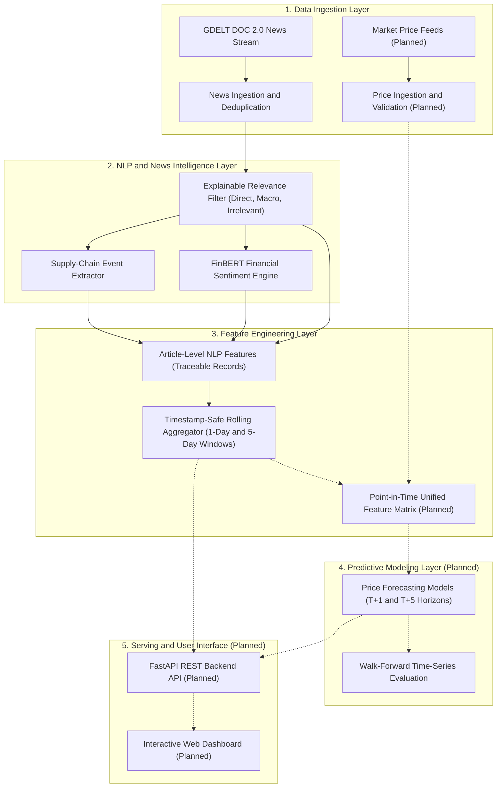

# AI-Powered Commodity Price Prediction and Supply-Chain Intelligence

An end-to-end artificial intelligence platform designed to forecast commodity price movements and analyze global supply-chain risks. The system synthesizes quantitative financial time-series data with unstructured global news intelligence—extracting domain-specific financial sentiment, supply-chain disruptions, and macroeconomic indicators with strict point-in-time temporal alignment.

---

## Table of Contents
1. [Project Overview](#1-project-overview)
2. [Problem Statement & Motivation](#2-problem-statement--motivation)
3. [Project Objectives](#3-project-objectives)
4. [Target Commodities](#4-target-commodities)
5. [Intended Prediction Horizons](#5-intended-prediction-horizons)
6. [Data Sources & Information Strategy](#6-data-sources--information-strategy)
7. [System Architecture & Planned Data Flow](#7-system-architecture--planned-data-flow)
8. [Team Roles & Responsibilities](#8-team-roles--responsibilities)
9. [Current Implementation Status](#9-current-implementation-status)
10. [Technology Stack](#10-technology-stack)
11. [Setup & Installation](#11-setup--installation)
12. [Usage Instructions](#12-usage-instructions)
13. [Testing & Quality Assurance](#13-testing--quality-assurance)
14. [NLP & News Intelligence Module Reference](#14-nlp--news-intelligence-module-reference)
15. [Limitations & Future Work](#15-limitations--future-work)
16. [Repository Workflow & Collaboration](#16-repository-workflow--collaboration)

---

## 1. Project Overview

Commodity markets are the foundation of the global industrial economy. Raw materials such as crude oil, copper, and gold dictate operating costs across manufacturing, transportation, electronics, and construction. Unlike traditional financial assets whose valuations largely reflect corporate earnings reports, commodity prices are acutely sensitive to real-world physical and geopolitical shocks—mine strikes, pipeline sabotage, shipping lane blockades, export tariffs, and unexpected inventory draws.

This project delivers an integrated machine learning and natural language processing (NLP) framework that continuously monitors global news streams, filters signal from noise, classifies supply-chain events, evaluates domain sentiment using FinBERT, and generates point-in-time feature vectors to forecast commodity price dynamics.

---

## 2. Problem Statement & Motivation

### The Challenge
1. **Extreme Volatility & Physical Sensitivity**: Commodity markets experience rapid price regime shifts driven by real-world physical disruptions and macroeconomic events that occur outside organized financial exchanges.
2. **Lag in Purely Quantitative Models**: Traditional econometric models (e.g., ARIMA, GARCH) and technical momentum indicators (e.g., RSI, MACD) extrapolate strictly from past price series. They have no visibility into breaking real-world disruptions until those shocks have already impacted market prices.
3. **Unstructured News Deluge & Noise**: Global news aggregators produce tens of thousands of articles daily. A vast majority of mentions are uninformative, boilerplate, figurative ("Olympic gold medal", "crude joke"), or tangential. Manual analysis cannot scale to capture these nuances in real time.
4. **Lookahead Data Leakage in Backtesting**: Incorporating news data into quantitative trading models frequently suffers from lookahead bias—evaluating news published *after* a trading cutoff as if it were known *prior* to that cutoff.

### Project Motivation
By pairing rigorous time-series econometric principles with automated, explainable NLP intelligence, this platform transforms unstructured global news into structured, timestamp-anchored features. This enables downstream machine learning models to capture early warning indicators of supply bottlenecks, demand shifts, and policy interventions with zero lookahead leakage.

---

## 3. Project Objectives

- **Automated Global News Ingestion**: Continuously discover and ingest commodity-focused news articles from the global GDELT DOC 2.0 API with robust rate-limiting and deduplication.
- **Explainable Relevance Classification**: Implement a rule-based, transparent relevance filter that separates direct operational commodity developments and macroeconomic drivers from sports, slang, and generic noise.
- **Financial Domain Sentiment Analysis**: Quantify article sentiment using a pretrained financial model (`ProsusAI/finbert`), distinguishing model confidence from directional sentiment polarity.
- **Supply-Chain Event Extraction**: Automatically extract operational disruptions, inventory changes, geopolitical conflicts, policy actions, and production shifts, mapping each event to an economically grounded impact hypothesis.
- **Timestamp-Safe Feature Engineering**: Construct standardized article-level datasets and backward-looking rolling window feature matrices ($T-1\text{d}$, $T-5\text{d}$) anchored strictly to point-in-time prediction cutoffs.
- **Multi-Horizon Price Forecasting**: Train and evaluate predictive machine learning models to forecast price return and directional movement across next-day and weekly horizons.
- **Interactive Decision Dashboard**: Serve predictions, risk alerts, sentiment timelines, and event feeds through a high-performance REST API and web user interface.

---

## 4. Target Commodities

The platform focuses on three benchmark commodities representing distinct industrial and economic segments:

| Commodity | Sector & Role | Key Supply-Chain & Price Drivers |
| :--- | :--- | :--- |
| **Copper (`copper`)** | **Industrial Metal ("Dr. Copper")**<br/>Primary barometer of global industrial and economic health. Vital for power grids, electric vehicles, electronics, and construction. | • Mining production disruptions & labor strikes (Chile, Peru, Indonesia)<br/>• Smelter operational bottlenecks and treatment charges<br/>• China manufacturing PMI and infrastructure stimulus<br/>• Warehouse inventory levels on LME, SHFE, and COMEX |
| **Gold (`gold`)** | **Precious Metal & Monetary Asset**<br/>Global safe-haven asset, store of value, and hedge against inflation and systemic risk. | • Central bank reserve accumulation policies<br/>• US Federal Reserve interest rate policy and real Treasury yields<br/>• US Dollar Index (DXY) currency fluctuations<br/>• Escalating geopolitical conflict and sovereign debt risk |
| **Crude Oil (`crude oil`)** | **Energy Benchmark (Brent / WTI)**<br/>Fundamental input for global transportation, thermal energy, petrochemicals, and macro inflation. | • OPEC+ production quotas and compliance adherence<br/>• Geopolitical tensions near transit choke-points (Strait of Hormuz, Red Sea)<br/>• US commercial crude inventories (EIA weekly petroleum status)<br/>• Refinery outages, pipeline stoppages, and strategic reserve releases |

---

## 5. Intended Prediction Horizons

Predictive modeling is structured around two distinct operational time horizons:

1. **Next Trading Day ($T+1$)**:
   - **Target**: Next business day price return ($\ln(P_{t+1}/P_t)$) and directional movement ($\text{sign}(\Delta P)$).
   - **Operational Objective**: Short-term tactical risk positioning. Captures immediate market absorption of breaking overnight news, unscheduled mine shut-ins, or sudden geopolitical escalations.
2. **Next Five Trading Days ($T+5$, One Trading Week)**:
   - **Target**: 5-day cumulative price return ($\ln(P_{t+5}/P_t)$) and weekly trend regime.
   - **Operational Objective**: Weekly strategic inventory planning and hedging. Captures persistent operational bottlenecks, cumulative inventory draws/builds, and the phased implementation of monetary and trade policy.

---

## 6. Data Sources & Information Strategy

The project integrates four primary streams of market information:

1. **Historical Market Prices (Planned)**: Daily OHLCV price series, log returns, realized volatility, and technical indicators (e.g., Simple/Exponential Moving Averages, RSI, MACD).
2. **Macroeconomic Indicators (Planned)**: Global manufacturing PMIs, US CPI/PPI inflation releases, central bank interest rate decisions, and weekly EIA/API petroleum status reports.
3. **News Sentiment Intelligence (Implemented)**: Domain-specific sentiment probabilities from FinBERT (`ProsusAI/finbert`), measuring winning-class model confidence, windowed net polarity, and confidence-weighted sentiment balance.
4. **Supply-Chain Events (Implemented)**: Rule-based identification of operational events (`supply_disruption`, `demand_change`, `geopolitical_risk`, `inventory_change`, `policy_action`, `production_change`) with directional market impact hypotheses (`potentially_bullish`, `potentially_bearish`).
5. **Strict Point-in-Time Alignment**: All news and event signals are aggregated strictly over backward-looking windows $[T_{\text{cutoff}} - W, T_{\text{cutoff}}]$. Any article published after $T_{\text{cutoff}}$ is strictly excluded to eliminate lookahead leakage.

---

## 7. System Architecture & Planned Data Flow

The platform follows a decoupled, modular layered architecture:



### Data Flow Overview:
1. **Discovery & Collection**: GDELT DOC 2.0 is queried with targeted Boolean filters; financial market APIs supply historical price data.
2. **Filtering & Normalization**: Articles are normalized into UTC timestamps, stripped of query artifacts, and filtered into 4-way relevance classes.
3. **Intelligence Extraction**: Directly and potentially relevant headlines pass through the FinBERT sentiment model and the rule-based event taxonomy.
4. **Feature Assembly**: Article records are joined via canonical composite keys `(commodity, url)` and aggregated into backward-looking rolling windows.
5. **Model Ingestion & Forecasting**: Aligned feature matrices feed machine learning models under walk-forward cross-validation.
6. **Delivery**: The backend API serves predictions, risk alerts, and sentiment feeds to the frontend user dashboard.

---

## 8. Team Roles & Responsibilities

The project is structured across five specialized engineering roles:

| Role | Domain | Primary Responsibilities |
| :--- | :--- | :--- |
| **MLOps 1** | **Data Engineering & Price Ingestion** | • Ingestion pipelines for historical and daily commodity market prices (OHLCV).<br/>• Price data cleaning, gap handling, dividend/split adjustments, and timestamp normalization.<br/>• Data validation, schema enforcement, and feature store persistence. |
| **MLOps 2** | **Price Prediction & Model Evaluation** | • Baseline forecasting models (Random Walk, ARIMA, Linear Regressors).<br/>• Advanced machine learning models (LightGBM, XGBoost, LSTM/GRU, Temporal Fusion).<br/>• Walk-forward cross-validation, hyperparameter tuning, and metric evaluation (MAE, RMSE, Directional Accuracy). |
| **MLOps 3** | **NLP & News Intelligence** *(Current Feature Branch)* | • News ingestion from GDELT DOC 2.0 with rate-limiting and deduplication.<br/>• Explainable 4-way news relevance classification.<br/>• Financial sentiment inference via FinBERT (`ProsusAI/finbert`).<br/>• Supply-chain event extraction and economic impact classification.<br/>• Point-in-time, leakage-safe rolling window feature aggregation. |
| **Web 1** | **Frontend Application** | • Modern interactive web user interface (React/TypeScript or Streamlit).<br/>• Commodity price chart visualization with forecast overlays and uncertainty bands.<br/>• News sentiment timeline, event alert notifications, and risk heatmaps. |
| **Web 2** | **Backend REST API** | • High-performance REST API service (FastAPI).<br/>• Endpoints serving price predictions, news sentiment histories, and event logs.<br/>• Caching layer, model inference orchestration, and OpenAPI documentation. |

---

## 9. Current Implementation Status

This repository is under active development. The table below delineates completed and committed modules from in-progress and planned components:

| Component | Responsible Role | Status | Notes |
| :--- | :--- | :--- | :--- |
| **News Ingestion & Deduplication** | MLOps 3 | ✅ **Implemented & Committed** | Rate-limited client, exponential backoff, URL deduplication (`run_pipeline.py`). |
| **Explainable News Relevance Filter** | MLOps 3 | ✅ **Implemented & Committed** | 4-way taxonomy, indicator extraction, noise filtering (`src/news_intelligence/relevance.py`). |
| **FinBERT Sentiment Analysis** | MLOps 3 | ✅ **Implemented & Committed** | Hugging Face Transformers integration, batching, lazy loading (`src/sentiment/`). |
| **Supply-Chain Event Extraction** | MLOps 3 | ✅ **Implemented & Committed** | 7 event classes, negation detection, economic impact rules (`src/event_extraction/`). |
| **Standardized NLP Feature Engineering** | MLOps 3 | ⏳ **Implemented (Local / Audit)** | Multi-source joining, point-in-time window aggregator, leakage filtering (`src/features/`, `run_features.py`). |
| **Price Data Ingestion & Validation** | MLOps 1 | 📋 **Planned** | Historical OHLCV ingestion pipelines and schema validation. |
| **Predictive Price Models (T+1, T+5)** | MLOps 2 | 📋 **Planned** | Baseline models, feature importance, and machine learning forecasters. |
| **Frontend Web Dashboard** | Web 1 | 📋 **Planned** | Interactive charts, risk heatmaps, and sentiment feeds. |
| **Backend REST API** | Web 2 | 📋 **Planned** | FastAPI endpoints for prediction serving and data integration. |
| **End-to-End Orchestration & CI/CD** | All | 📋 **Planned** | Automated ingestion schedules, Docker Compose containerization. |

---

## 10. Technology Stack

The repository utilizes the following verified technologies and dependencies:

- **Programming Language**: Python 3.10+ (tested on Python 3.14).
- **Deep Learning & Natural Language Processing**:
  - `torch` (PyTorch) — Neural compute backend for model inference.
  - `transformers` (Hugging Face) — Model loading and inference pipeline for `ProsusAI/finbert`.
- **HTTP & Network Ingestion**:
  - `requests` — HTTP communication with the GDELT DOC 2.0 API, configured with custom headers, polite rate-limiting delays, and exponential backoff.
- **Testing & Quality Assurance**:
  - `pytest` — 100% offline unit and integration test suite with synthetic fixtures and zero external network calls.
- **Data Storage & Serialization**:
  - Standard Library `json` & `pathlib` — Append-only JSON Lines (`.jsonl`) datasets for lightweight, transparent, and inspectable intermediate stages.
- **Planned Stack Additions**:
  - `fastapi` & `uvicorn` (Backend REST API)
  - `scikit-learn` & `lightgbm` (Price forecasting models)
  - `react` / `typescript` / `tailwind` (Frontend user interface)
  - `docker` & `docker-compose` (Containerized deployment)

---

## 11. Setup & Installation

### Prerequisites
- Python 3.10 or higher.
- Git.

### Step 1: Clone the Repository
```bash
git clone https://github.com/Adhvaithmutyam/AI-powered-Commodity-Price-Prediction-and-Supply-Chain-Intelligence-.git
cd AI-powered-Commodity-Price-Prediction-and-Supply-Chain-Intelligence-
```

### Step 2: Checkout the Feature Branch
```bash
git checkout feature/news-intelligence
```

### Step 3: Create and Activate a Virtual Environment
- **On Windows (PowerShell)**:
  ```powershell
  python -m venv .venv
  .\.venv\Scripts\Activate.ps1
  ```
- **On Linux / macOS (Bash)**:
  ```bash
  python -m venv .venv
  source .venv/bin/activate
  ```

### Step 4: Install Dependencies
```bash
pip install -r requirements.txt
```

---

## 12. Usage Instructions

The implemented NLP intelligence modules can be executed independently or sequentially via their CLI runners:

### 1. Ingest Raw News Articles
Fetches the latest commodity news records from GDELT DOC 2.0 using targeted domain queries:
```bash
python run_pipeline.py
```
*Optional Flag:* `--assess-relevance` applies the explainable relevance classifier during ingestion.
*Default Output:* `data/raw/commodity_news.jsonl`

### 2. Evaluate News Relevance
Evaluates ingested records against operational and macroeconomic signal indicators:
```bash
python run_relevance_eval.py --input data/raw/commodity_news.jsonl
```

### 3. Run FinBERT Financial Sentiment Analysis
Processes ingested records through the pretrained `ProsusAI/finbert` model:
```bash
python run_sentiment.py
```
*Default Output:* `data/processed/commodity_news_sentiment.jsonl`

### 4. Run Supply-Chain Event Extraction
Extracts concrete supply-chain events and evaluates directional market impact:
```bash
python run_event_extraction.py
```
*Default Output:* `data/processed/commodity_events.jsonl`

### 5. Generate Standardized NLP Feature Datasets
Combines sentiment, relevance, and event data into standardized article-level features and computes timestamp-safe rolling window aggregations:
```bash
python run_features.py --cutoff 2026-10-20T12:00:00Z --windows 1,5
```
*Optional Flags:*
- `--cutoff <ISO_TIMESTAMP>`: Point-in-time prediction cutoff (defaults to latest article timestamp).
- `--windows 1,5`: Comma-separated list of backward-looking window horizons in days.
- `--commodities copper,gold,crude oil`: Target commodities to process.
- `--skip-aggregated`: Skips window aggregation and builds only article-level features.
*Outputs:*
- `data/processed/nlp_article_features.jsonl` (article-level features)
- `data/processed/nlp_aggregated_features.jsonl` (windowed rolling features)

---

## 13. Testing & Quality Assurance

The test suite is engineered for **100% offline execution with zero network access and zero external model downloads**. All tests run against synthetic JSON fixtures and mocked API clients.

To execute the full test suite:
```bash
python -m pytest -v
```

### Test Suite Structure:
- **`tests/test_client.py` (10 tests)**: Verifies GDELT API rate-limiting delays, exponential backoff, HTTP 429/5xx status handling, and network timeouts.
- **`tests/test_normalizer.py` (10 tests)**: Validates UTC timestamp parsing, ISO conversion, URL extraction, and whitespace stripping.
- **`tests/test_storage.py` (5 tests)**: Confirms JSONL record persistence, append mechanics, and cross-batch `(commodity, url)` deduplication.
- **`tests/test_pipeline.py` (4 tests)**: Tests end-to-end news ingestion orchestration and graceful partial failure recovery.
- **`tests/test_relevance.py` (19 tests)**: Validates 4-way classification, direct operational mining/oil signals, macroeconomic drivers (Fed rate cuts, CPI, PMI), sports/slang noise filtering, and schema preservation.
- **`tests/test_sentiment.py` (10 tests)**: Tests FinBERT output mapping, batch inference, lazy model initialization, and malformed text fallback.
- **`tests/test_event_extraction.py` (22 tests)**: Validates event classification across all 7 taxonomy classes, negation detection (e.g., "strike averted"), commodity-specific geopolitical rules, and missing data handling.
- **`tests/test_features.py` (19 tests)**: Verifies multi-source record joining, URL canonicalization, UTC timestamp normalization, exact window boundary inclusion/exclusion, strict future leakage filtering, unanchored timestamp handling, confidence mean vs. polarity calculations, relevant-only sentiment isolation, cutoff auditing, and pipeline execution.

*Total: 80 committed tests on `feature/news-intelligence` (expanding to 99 tests with the local Task 5 module).*

---

## 14. NLP & News Intelligence Module Reference

### Project Directory Layout
```text
├── .gitignore                      # Excludes venv, datasets (.jsonl), model weights, caches
├── requirements.txt                # Production dependencies (torch, transformers, requests, pytest)
├── run_pipeline.py                 # News ingestion CLI runner
├── run_sentiment.py                # FinBERT sentiment CLI runner
├── run_event_extraction.py         # Supply-chain event extraction CLI runner
├── run_relevance_eval.py           # Relevance evaluation CLI runner
├── run_features.py                 # NLP feature engineering CLI runner
├── data/
│   ├── raw/                        # Ingested news records (git-ignored)
│   └── processed/                  # Enriched sentiment, event, and feature datasets (git-ignored)
├── src/
│   ├── news_intelligence/          # News ingestion, normalizer, and relevance module
│   ├── sentiment/                  # FinBERT financial sentiment inference module
│   ├── event_extraction/           # Rule-based supply-chain event extraction module
│   └── features/                   # Standardized feature builder & timestamp aggregator module
└── tests/                          # 100% offline unit and integration test suite
```

### Data Schemas

#### Article-Level NLP Feature Record (`nlp_article_features.jsonl`)
```json
{
  "commodity": "copper",
  "article_url": "https://reuters.com/copper-strike",
  "article_title": "Chilean copper mine strike halts operations",
  "article_publication_timestamp": "2026-10-20T10:00:00Z",
  "domain": "reuters.com",
  "language": "English",
  "source_country": "Chile",
  "fetch_timestamp": "2026-10-20T11:00:00Z",
  "provider": "gdelt",
  "relevance_class": "directly_relevant",
  "relevance_score": 0.88,
  "relevance_explanation": "Headline explicitly references target commodity and operational/market signals (mining_production, supply_disruption). Assessment based on headline analysis; full article text was not analyzed.",
  "matched_relevance_indicators": ["commodity_copper", "mining_production", "supply_disruption"],
  "sentiment_label": "negative",
  "sentiment_score": 0.9412,
  "sentiment_model": "ProsusAI/finbert",
  "sentiment_status": "success",
  "event_type": "supply_disruption",
  "event_impact_direction": "potentially_bullish",
  "event_confidence": 0.88,
  "extraction_status": "success",
  "evidence_fact": "mine strike halts operations",
  "implication_rationale": "Stoppage curtails refined copper supply.",
  "feature_status": "complete"
}
```

#### Windowed Aggregated Feature Record (`nlp_aggregated_features.jsonl`)
```json
{
  "commodity": "copper",
  "cutoff_timestamp": "2026-10-20T12:00:00Z",
  "cutoff_source": "explicit",
  "window_days": 1,
  "window_start_timestamp": "2026-10-19T12:00:00Z",
  "window_end_timestamp": "2026-10-20T12:00:00Z",
  "article_count": 3,
  "relevant_article_count": 2,
  "directly_relevant_count": 1,
  "potentially_relevant_count": 1,
  "irrelevant_count": 1,
  "uncertain_count": 0,
  "relevance_score_mean": 0.5667,
  "sentiment_positive_count": 1,
  "sentiment_negative_count": 1,
  "sentiment_neutral_count": 1,
  "sentiment_missing_count": 0,
  "sentiment_confidence_mean": 0.8000,
  "sentiment_score_mean": 0.8000,
  "net_sentiment_polarity": 0.0000,
  "confidence_weighted_sentiment_polarity": -0.0333,
  "relevant_sentiment_positive_count": 1,
  "relevant_sentiment_negative_count": 1,
  "relevant_sentiment_neutral_count": 0,
  "relevant_net_sentiment_polarity": 0.0000,
  "relevant_confidence_weighted_polarity": -0.0500,
  "event_type_counts": {
    "supply_disruption": 1,
    "demand_change": 1,
    "geopolitical_risk": 0,
    "inventory_change": 0,
    "policy_action": 0,
    "production_change": 0,
    "other": 1
  },
  "event_impact_counts": {
    "potentially_bullish": 1,
    "potentially_bearish": 1,
    "mixed": 0,
    "unknown": 1
  },
  "high_confidence_event_count": 2,
  "relevant_high_confidence_event_count": 2,
  "future_articles_filtered": 0,
  "unanchored_articles_excluded": 0
}
```

### Econometric Anti-Leakage & Polarity Protocols
1. **Model Confidence vs. Directional Strength**: The FinBERT `sentiment_score` denotes winning-class posterior probability (softmax confidence $\in [0, 1]$). It is **not** a signed indicator of market direction. The aggregator tracks model confidence separately via `sentiment_confidence_mean` while calculating directional balance via `net_sentiment_polarity` ($\frac{\text{pos} - \text{neg}}{N}$) and `confidence_weighted_sentiment_polarity`.
2. **Relevance Isolation**: Metrics prefixed with `relevant_*` are computed exclusively over articles tagged `directly_relevant` or `potentially_relevant`. Irrelevant noise (e.g., sports coverage, casual idioms) is strictly quarantined to prevent false signal corruption.
3. **Point-in-Time Cutoff Enforcement**: Articles published after $T_{\text{cutoff}}$ are strictly filtered out (tracked in `future_articles_filtered`). In historical backtesting, passing `--cutoff` matching the historical price date is required to prevent lookahead bias.

---

## 15. Limitations & Future Work

### Current System Limitations
1. **Headline-Only Analysis**: The GDELT DOC 2.0 API provides article titles and URLs, but not full body text. Relevance scoring and event extraction represent headline-level signals.
2. **Sample Density in Prototype Runs**: Initial local runs operate on small batches (~15 records). Rolling window aggregations reflect sparse counts until automated scheduled ingestion runs over extended periods.
3. **Vocabulary Coverage**: Event extraction utilizes domain-specific regex and keyword patterns. While robust for standard financial reporting, unusual phrasing may be classified as `other`.
4. **Intermediate Storage**: Current intelligence components store outputs in flat JSONL files. Full enterprise deployment requires a unified database and time-series feature store.

### Planned Enhancements
- **Multi-Modal Alignment**: Join rolling window NLP feature vectors with historical price series for walk-forward model training.
- **Few-Shot LLM Fallback**: Implement a lightweight local LLM fallback for ambiguous headlines classified as `uncertain` or `other`.
- **Scheduled Automated Ingestion**: Deploy scheduled background workers to continuously ingest news and prices.
- **Dockerized Deployment**: Containerize the pipeline, API, and dashboard using Docker Compose.

---

## 16. Repository Workflow & Collaboration

To maintain code quality and prevent integration conflicts across team roles:

### Git Branching Strategy
- **`main`**: Protected branch containing only production-ready, peer-reviewed, and fully tested code.
- **Feature Branches**: All active development occurs on designated feature branches named by role or capability:
  - `feature/news-intelligence` — MLOps 3 (NLP, sentiment, event extraction, feature datasets)
  - `feature/price-data` — MLOps 1 (price data engineering and validation)
  - `feature/price-prediction` — MLOps 2 (price forecasting models and evaluation)
  - `feature/frontend` — Web 1 (dashboard and UI components)
  - `feature/backend` — Web 2 (FastAPI service and endpoints)

### Pull Request & Commit Guidelines
- **Atomic Commits**: Keep commits focused on specific deliverables with clear, imperative commit messages.
- **Offline Test Pass**: All tests (`python -m pytest -v`) must pass before pushing or opening a Pull Request.
- **Data Exclusion**: Never commit generated datasets (`data/raw/*.jsonl`, `data/processed/*.jsonl`), virtual environments (`.venv/`), model weights, `.env` files, or API credentials.
- **Code Review**: Pull requests into `main` require review and sign-off by team members.